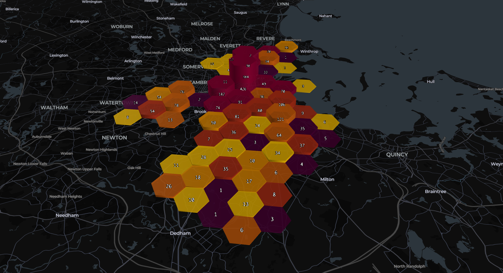
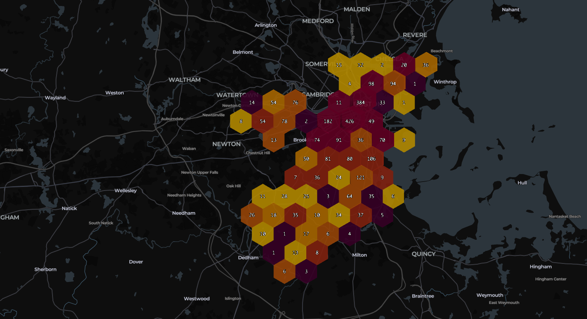

# Boston Airbnb Prices

A data analysis project exploring whether Boston Airbnb listings are priced above or below comparable listings, how those price differences relate to guest ratings, and whether listing characteristics can help identify “good deals.”

## Research questions

- How does a listing's nightly price compare with listings that have similar capacity, room type, property type, location, and amenities?
- Are listings priced below their predicted price more highly rated?
- Can listing characteristics help predict listings that are both relatively inexpensive and well rated?

## Data

The analysis uses Boston listings from the Inside Airbnb scrape dated **June 15, 2026**. The data contains 4,378 listings and 90 fields. The target `price` is a nightly price quote in US dollars. The CSV is downloaded by the analysis from Inside Airbnb:

<https://data.insideairbnb.com/united-states/ma/boston/2026-06-15/data/listings.csv.gz>

Inside Airbnb data is provided under [CC BY 4.0](https://creativecommons.org/licenses/by/4.0/). The source file is not included in this repository; the analysis downloads it when run. Availability of the source URL may change over time.

## Approach

1. Remove identifier and unusable columns, convert price strings to numeric, deduplicate listings, and fill missing bathroom, bed, and bedroom counts with their medians.
2. Explore price, review score, room type, capacity, and neighborhood patterns.
3. Fit a linear regression model to log nightly price using listing attributes. Define relative price from its residual: underpriced below `-0.2`, fair between `-0.2` and `0.2`, and overpriced above `0.2`.
4. Define a “good deal” as underpriced with a review rating of at least `4.82` (excluding the value rating from the rating comparison).
5. Compare logistic regression, decision tree, and random forest classifiers for predicting good deals, using stratified validation and precision/recall/F1 metrics.
6. Export the cleaned listing data and visualize it in Kepler.gl.

## Findings

In the analyzed subset, **28.1% of listings** were classified as underpriced, **46.2%** as fair, and **25.7%** as overpriced. **374 listings (13%)** met the project’s good-deal definition. Price and overall rating had only a weak relationship in the analysis; a lower-than-expected price did not by itself imply a higher rating.

The linear regression reported an R² of **0.814** on the held-out test data. The logistic regression estimated higher odds for good-deal listings in West Roxbury (odds ratio 2.64) and Mattapan (2.38), relative to its reference neighborhood and holding other included features constant. These findings are descriptive of this scrape and depend on the selected features, filters, thresholds, and train/test split. The classifier threshold and validation results are documented in the exported analysis.

## Kepler.gl maps

The maps below are screenshots from the Kepler.gl exploration.





## Run the analysis

The original Colab notebook is available [here](https://colab.research.google.com/drive/14nGxJMV6r-9GXozX4byNJ5cNgb6PECT5?usp=sharing). A text export of the notebook content is included as [`analysis-export.md`](analysis-export.md).

Install dependencies in a Python environment:

```bash
python -m pip install -r requirements.txt
```

Then run the analysis from a notebook or Python session. It reads the source CSV directly from Inside Airbnb, so an internet connection is needed. The Kepler.gl screenshots are static exports; the original notebook/export contains the analysis context but does not bundle an interactive Kepler.gl map.

## Repository contents

- `README.md` — project overview, methods, findings, and map screenshots
- `analysis-export.md` — text export of the Colab analysis
- `kepler-map*.png` — Kepler.gl map images
- `requirements.txt` — Python packages used by the analysis

## Limitations

- Listing prices are quotes for a particular stay and can reflect length-of-stay discounts; they are not necessarily a stable nightly rate.
- Airbnb listing details are host-provided or platform-displayed and are not independently verified.
- The “good deal” label uses chosen residual and rating cutoffs, so it is a project-specific definition rather than an objective market judgment.
- The classifier predicts this constructed label; its results should not be interpreted as causal or as a guarantee of value.
